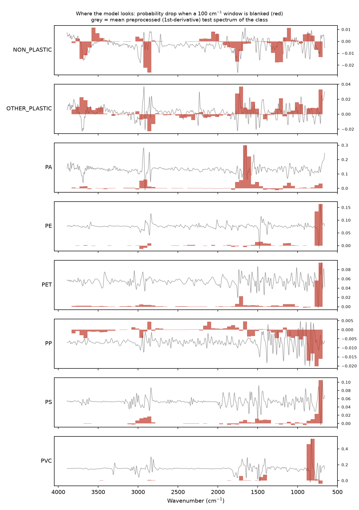
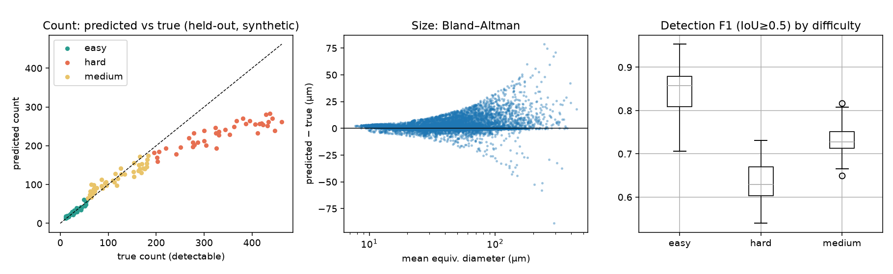
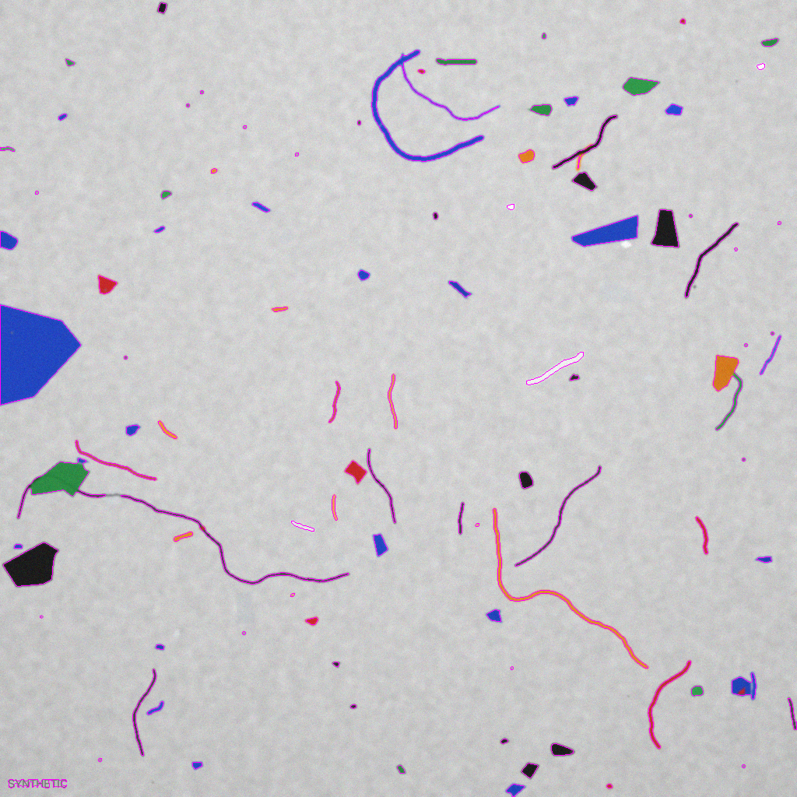
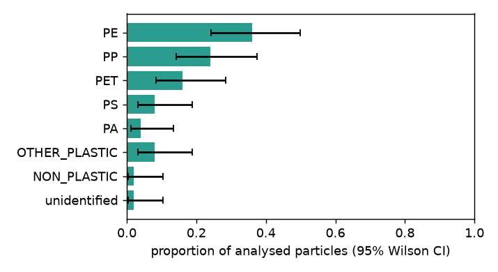

# Microplastics Screening Pipeline: Polymer Identification from FTIR Spectra and Particle Counting from Filter Images

> **Draft for the team to finish.** All numbers below come from scripts in this repository (named in each section).
> Items marked **[TEAM TO COMPLETE]** need information or work only the team can supply (community component, literature
> citations beyond those listed). Nothing marked that way has been invented.

## 1. Abstract
Identifying microplastics normally needs µ-FTIR or Raman spectroscopy and a trained analyst, so it is slow and
expensive. We built an open prototype that (i) identifies the polymer of a particle from its FTIR spectrum and (ii)
counts and sizes particles on a filter-membrane image, then (iii) combines both into one sample report with an explicit
confidence level. On 145 held-out particles (1,247 spectra) from the Zenodo FTIR plate-reader database, a calibrated
PCA + SVM classifier reached **87.7 % accuracy, macro-F1 0.873**, and **95.2 % accuracy on the 73 % of spectra it was
confident about**. The image module, a classical segmentation pipeline, was validated **only on synthetic images**:
on 120 held-out images the predicted count correlated with the true count at r = 0.97 with a mean absolute count error
of 19.7 %, and size error (equivalent diameter) was 3.0 µm on average. The image module is a **proof of concept, not a
validated measurement**. The tool is for screening and education, not regulatory use.

## 2. Introduction and problem
Microplastics (plastic particles < 5 mm) occur in water, sediment and food. Confirming that a particle is plastic, and
which polymer, normally requires spectroscopy of each particle, which takes hours per sample and expert interpretation.
Cheap, fast screening would let more places monitor water quality. **[TEAM TO COMPLETE: add scale-of-the-problem
statements with citations (e.g. WHO, UNEP, peer-reviewed reviews). We have deliberately not quoted figures we have not
verified.]**

## 3. SDG justification
| SDG / target | How this tool could contribute | What it could inform | What it does **not** do |
|---|---|---|---|
| **SDG 14 – Life Below Water, 14.1** (reduce marine pollution incl. marine debris) — primary | Cheaper, faster screening of water/sediment samples for polymer type and particle load | Local monitoring of microplastic load; prioritising samples for full lab analysis | Not a validated monitoring method; does not measure ecological harm |
| **SDG 6 – Clean Water, 6.3** (water quality) | Screening of surface/drinking-water filters | Triage of samples | No health-based threshold; not a compliance test |
| SDG 12 – Responsible Consumption, 12.5 (waste reduction) — secondary | Polymer composition hints at sources (e.g. PET bottles/fibres, PE films) | Source-attribution discussions | Does not attribute a particle to a specific product |

We argue SDG 14 is primary because the tool targets the monitoring gap, not pollution itself. We avoid claiming it
reduces pollution.

## 4. Community component  **[TEAM TO COMPLETE]**
No community activity has been carried out by the code or by this draft. Options from `docs/08`: (1) a citizen-science
sampling kit protocol (filter + phone photo with scale card) feeding the image module; (2) 3–5 stakeholder interviews
(water-quality officers, teachers, NGOs, lab technicians); (3) an awareness session with pre/post survey; (4) plain-
language open-source documentation; (5) a local pilot with permission. For whichever is chosen, document: who, how many,
consent, what was learned, and what changed in the project. Keep personal data out of the report.

## 5. Methods
**5.1 Spectral data.** Zenodo record 10.5281/zenodo.10126851 (Cowger et al. 2024; CC BY-NC 4.0): 6,256 de-duplicated
FTIR spectra after filtering, in three measurement modes (ATR, reflectance, transmission), from published libraries
and measured particles on sample plates. Labels were mapped to 8 classes (PET, PE, PP, PS, PVC, PA, OTHER_PLASTIC,
NON_PLASTIC); unresolvable labels were dropped (`src/spectra/labels.py`, `load.py`).
**5.2 Preprocessing.** Savitzky–Golay smoothing, asymmetric least-squares baseline removal, first derivative and SNV
normalisation on a common 660–3890 cm⁻¹ grid, identical at train and inference time (`preprocess.py`).
**5.3 Classifier.** Four models (PCA + SVM, random forest, correlation-kNN, logistic regression) were compared with
**particle-grouped** 5-fold cross-validation (all spectra of one physical particle stay in the same fold) on 80 % of
particles. The final PCA + SVM was sigmoid-calibrated and scored once on the untouched 20 % (`train.py`, `final.py`).
**5.4 Prediction and interpretation.** `predict.py` applies the same pipeline to a raw two-column file and abstains
below probability 0.5. `interpret.py` blanks 100 cm⁻¹ windows one at a time and measures the drop in true-class
probability (occlusion analysis).
**5.5 Images.** No licence-clear real filter images were obtained, so a **synthetic generator** (`src/images/synth.py`)
produces 150 labelled brightfield images (50 each easy/medium/hard; 10–500 particles; log-normal sizes; fragments,
fibres, films; blur, noise, uneven light, dust and scratch distractors) with per-particle ground truth. Everything is
prefixed `SYNTH_`, tagged in the image and in JSON (`is_synthetic = true`). Segmentation (`segment.py`): median-filter
background estimate → colour-difference map → hysteresis threshold → per-particle edge refinement at 50 % of local
contrast → watershed for touching compact blobs → minimum area 15 px (= 60 µm² at 2 µm/pixel). Measurement (`measure.py`):
equivalent diameter, max Feret diameter, aspect ratio, shape class, size bins, D10/D50/D90 and a Low/Medium/High image
confidence from small-particle fraction, ambiguity, noise and crowding.
**5.6 Validation split.** Thresholds were tuned on images 1–30 (dev); **results are reported on images 31–150**
(held-out). Matching uses IoU ≥ 0.5.
**5.7 Combination.** `combine.py` runs both branches, reports polymer proportions with 95 % Wilson intervals,
extrapolates to the filter *under the stated random-subsample assumption*, computes particles/L, and sets overall
confidence = the lowest of image level, spectral level (mean identified probability × (1 − abstained)) and a
sample-size cap.

## 6. Results
**6.1 Spectral classifier** (`outputs/cv_results.json`, `outputs/confusion_test.csv`). Grouped 5-fold CV accuracy:
random forest 0.847, PCA + SVM 0.838, kNN 0.821, logistic regression 0.801 (macro-F1 0.73–0.77). On the held-out
test set the calibrated SVM scored **accuracy 0.877, macro-F1 0.873**; per-class F1: PET 0.954, PP 0.911, PE 0.900,
PS 0.851, OTHER_PLASTIC 0.843, NON_PLASTIC 0.788, PA 0.737, PVC 1.000 (**8 spectra ≈ 1 particle — not meaningful**).
Accuracy by measurement mode in CV: reflectance 0.887, transmission 0.853, **ATR 0.678**.
Confidence vs coverage: ≥ 0.5 → 94 % of spectra answered, 90.5 % correct; ≥ 0.7 → 73 % answered, 95.2 % correct.
Most frequent confusions (test): PE→PS (19), OTHER_PLASTIC→NON_PLASTIC (19), PP→OTHER_PLASTIC (12), PA→NON_PLASTIC (11).


*Occlusion importance per class. Peaks fall on chemically expected regions (PA ≈ 1650 cm⁻¹ amide I; PET ≈ 1720 cm⁻¹
C=O; PVC ≈ 800–850 cm⁻¹). Several classes also depend on the lowest-wavenumber edge (≈ 700 cm⁻¹), which may partly
reflect real bands but could also be an edge/baseline effect; PP importance is weak and noisy.*

**6.2 Image module — synthetic data only** (`outputs/image_validation.json`, held-out 120 images):

| Subset | Count MAPE | Count r | Detection precision | Recall (≥ 15 px) | F1 | Equiv.-diameter MAE |
|---|---:|---:|---:|---:|---:|---:|
| All | 19.7 % | 0.97 | 0.78 | 0.72 | 0.74 | 3.0 µm |
| Easy | 14.4 % | 0.96 | 0.83 | 0.87 | 0.84 | 1.1 µm |
| Medium | 14.8 % | 0.92 | 0.74 | 0.74 | 0.73 | 2.3 µm |
| Hard | 29.8 % | 0.89 | 0.78 | 0.54 | 0.64 | 3.7 µm |

The module **under-counts in crowded images** (mean bias −107 particles on hard images) because overlapping particles
merge; it also over-estimates fibre size (bias +4.2 µm vs +1.3 µm for fragments). Particles below 15 px (≈ 3 % of
ground-truth particles) are by design not detected. The image confidence level is informative on this data: held-out
images labelled High had 14.6 % mean count error, Medium 27.0 % (none was Low).



**6.3 Combined demo** (`run_sample.py samples/sample_001`, a **constructed** sample: synthetic image + spectra from
held-out test particles). 97 particles detected (97 particles/L at 1 L); 50 spectra identified PE 36 %, PP 24 %, PET 16 %,
PS 8 %, PA 4 %, OTHER_PLASTIC 8 %, NON_PLASTIC 2 %, unidentified 2 % versus the chosen composition PE 40 %, PP 24 %,
PET 16 %, PS 8 %, PA 4 %, OTHER 8 %. Overall confidence: **Medium** (spectral score 0.77 limits it).




## 7. Discussion
The classifier is strong for the common polymers (PET, PP, PE) and weak for PA, ATR spectra and the heterogeneous
OTHER/NON-plastic classes, matching the data: PA has 23 particles, ATR is under-represented. Abstaining at 0.7 trades
coverage for accuracy and is the recommended operating point for screening. For images, a classical pipeline suffices
for sparse samples; crowding is the main failure mode, and the report states it through the confidence level.

## 8. Limitations and honesty statement
1. **The image module is a proof of concept validated on synthetic images only**; no real filter images were used, so
   real-world accuracy is unknown and may be much lower. Segmentation parameters were tuned on synthetic data.
2. Optical imaging cannot identify plastic: counts are particles of interest, not confirmed plastics.
3. The demo samples are **constructed**; the pipeline has not been run on a field sample.
4. **PVC is not validated** (7 particles in the data; 1 in the test set). PA is weak; ATR is weak.
5. Library/plate spectra are cleaner than weathered, dirty or biofouled environmental particles (domain shift); the
   data come from one family of libraries/instruments.
6. Label noise from free-text labels mapped by rules; FTIR only (no Raman); no formal uncertainty on the 95 % intervals
   beyond the binomial assumption of random subsampling.
7. The scale (2 µm/pixel) is assumed for synthetic images; real images need scale-bar calibration.
8. **Non-commercial licence** (CC BY-NC 4.0) on the training data.
Not for regulatory, compliance or health decisions.

## 9. Ethics, data and licences
Data: Zenodo 10.5281/zenodo.10126851, CC BY-NC 4.0, cite Cowger et al. 2024. No personal data are used so far. Any
community component needs informed consent and anonymisation. Full source log: `data/DATA_SOURCES.md` (local only).

## 10. Future work
Real, labelled filter images with scale bars; more ATR/PA/PVC spectra (e.g. the Open Specy library); Raman; deep
learning (1D-CNN, U-Net/Cellpose) against the classical baselines; noise-robustness tests; field validation with a lab.

## 11. References
* Cowger W. et al. (2024) Generation of macro- and microplastic databases by high-throughput FTIR analysis with
  microplate readers. *Analytical and Bioanalytical Chemistry* 416(6), 1311–1320. DOI 10.1007/s00216-024-05127-w.
  Data: DOI 10.5281/zenodo.10126851.
* Cowger W. et al. (2021) Microplastic Spectral Classification Needs an Open Source Community: Open Specy to the
  Rescue! *Analytical Chemistry*. DOI 10.1021/acs.analchem.1c00123.
* De Frond H., Rubinovitz R., Rochman C. (2021) µATR-FTIR Spectral Libraries of Plastic Particles (FLOPP and FLOPP-e).
  *Analytical Chemistry* 93(48). DOI 10.1021/acs.analchem.1c02549.
* Primpke S. et al. (2018) FTIR spectral library for microplastic identification (cited in the dataset metadata).
* **[TEAM TO COMPLETE]** SDG and problem-scale sources (UN SDG indicators framework; WHO / UNEP microplastics reports).

## Appendix: reproduce
```bash
python -m src.spectra.load && python -m src.spectra.train && python -m src.spectra.final
python -m src.spectra.interpret
python -m src.images.synth --n 150 && python -m src.images.validate
python -m src.report.make_demo && python run_sample.py samples/sample_001
python -m pytest -q tests
```
